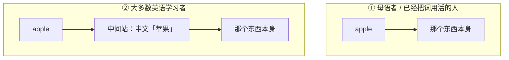
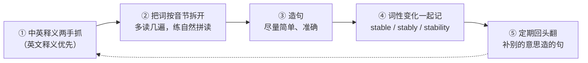
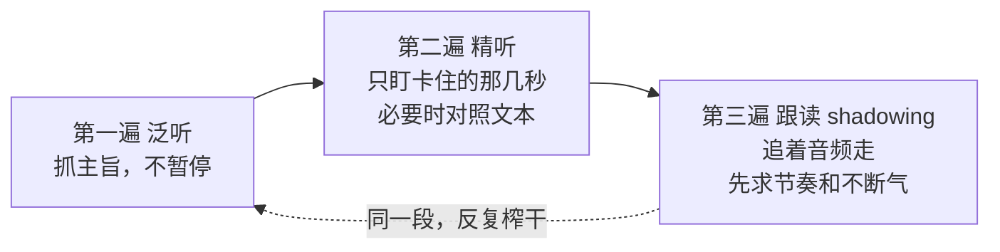
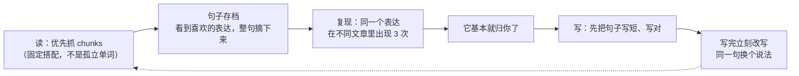
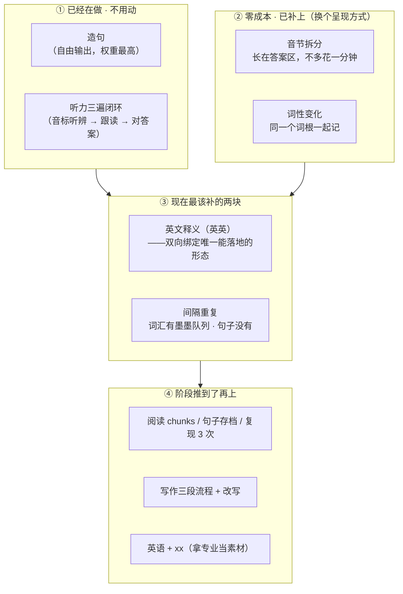

\---  
title: 英语学习方法：三篇文章的吸收与落地  
description: 把「输入/输出」「双向绑定」「词汇五步」「听力三遍闭环」拆成能看懂的图，再对照我自己的 90 天计划，看哪些已经落地、哪些还差。  
tags:  
\- 英语  
\- 英语学习方法  
date: 2026-09-26  
\---

我在 [[四级英语记录]] 里记了自己怎么一路瞎学过来的：下了个背单词软件，直接开背，只有视觉记忆，音标没系统学过，所以也读不出、说不出。

后来读到三篇文章，作者是雅思 7.5、把英语当工作语言的人：

- [学习词汇的方法：从背单词到用英语思考](https://www.chengliang.pro/英语/学习词汇的方法)
- [英语不需要"学完"：从刷题转向真实使用](https://www.chengliang.pro/英语/英语不需要学习)
- [英语学习之道：从词汇、听力到写作的完整方法](https://www.chengliang.pro/英语/英语学习之道)

三篇加起来讲了词汇、听力、口语、阅读、写作五块。这篇是我的**吸收笔记**——不是把它们复述一遍，而是拆成图、再对照我自己那份 90 天计划，看**哪些我已经在做了、哪些还差**。

## 一、底层模型：语言只有两件事

第一篇《英语不需要学习》里最狠的一句是：**英语是不需要"学"的**。

不是说词典和语法没用，而是说——它们**是工具，不是目的**。你把英语当成一门"等着学完的课程"，就会永远停在准备阶段：总觉得再背一些单词、再学一点语法、再看几节课，自己才"有资格"开口。结果是学了很久，从来没真正用过。

那语言的本质是什么？作者给了个特别简单的切法：

> 语言本质上就是「理解」和「使用」，对应「输入」和「输出」。

听力、阅读、口语、写作，拆到最后都在这两件事里。所以「学会一门语言」的路径不是学完再使用，而是**直接去使用**——在使用中遇到问题，再回头查一个词、弄懂一条规则。

注意那条虚线。**学习（查词、学语法）是挂在回路上的一个补丁，不是主线。** 这跟我过去的做法正好相反：我把补丁当成了主线，一直在"准备"，回路一次没跑起来。

## 二、词汇的秘密：中间不要站着中文

这是三篇里最该带走的一条，作者原话是「**这一点请你务必带走，伴随你整个语言学习生涯**」。

先想一个问题：你脑子里的「键盘」这个词，是怎么跟实物绑上的？我说"键盘"，你脑中出现的是一把键盘，**不是"键盘"这两个字**。你已经把**实体**和**词汇**直接绑定了。

母语者学英语也是这样：看到一种没见过的虫子，问一句 "What's this?"，得到答案 grasshopper —— 从此 **grasshopper 就和那只虫子绑上了**，中间不需要任何中文。

而大多数英语学习者的路径是这样的：先拿到 `apple`，再把它转成中文「苹果」，然后才在中文的舒适区里去取出那个「🍎」。

中间多出来的那一站，就是障碍。

把它想成程序里的键值对：程序员拿 `key` 取 `value`，一次检索；而大多数人要拿 EnglishKey 先换一个 ChineseKey，再拿 ChineseKey 去检索。**多一层转换，慢一倍，还多一个出错的地方。**

那怎么把中间站拆掉？作者的做法是**用英文解释英文**——因为不管哪种语言，复杂的词都能用简单的词解释。小朋友查 `strike`，看到的不是「击打」，而是 *hit forcibly and deliberately with one's hand or a weapon*。里面还有生词，就继续用同样的方式查下去。

### 具体怎么做（五步）

作者给了一套可以照做的流程：

其中第 ② 和第 ④ 步是我原来完全没做的：

- **拆音节**：音标解决的是"这个符号怎么读"，而**音节解决的是"拼写怎么对应声音"**——看到 `impossible` 不再是一串字母，而是 `im-pos-si-ble` 四块。这是拆长词的第一把刀。
- **词性变化**：`necessary / necessarily / necessity` 一起记。一个词根派生出一串亲戚，比一个个孤立地背**省一个数量级**，而且规律是看得见的（-ly 副词、-ness / -ity 名词）。

第 ⑤ 步我原本也没有：**笔记写完不能束之高阁**。因为一词多义很常见，第一次不可能学完一个词的全部用法，之后可以在笔记里补上"用别的意思造的句"。

## 三、听力：给大脑建一本语音词典

作者听力 8.5。别人问他怎么考的，他只回一句：**因为我听得懂。**

他说了一句我认为最该记的话：

> 听不懂的时候，你缺的往往不是某条语法，而是"**这个声音到底对应哪个词、哪个短语**"。

也就是说，听力练的不是"做题"，而是**给你的大脑建一本语音词典**。词典里没有这一条，你就永远要在脑子里"拼读音 → 猜单词"。

他还给了一个顺序上的判断：**听力是口语的上限**。你想把口语说得像样，前提是你先把"像样的英语"听进耳朵里。

练法上有个特别省力的闭环——**同一段材料反复榨干**：

这一段跟我 90 天计划里的听力时段（音标听辨 10 + 逐句跟读 15 + 对答案 5）**结构上是一回事**——三遍各有分工，只是我的材料还是教学音频（零基础阶段听得懂才有用）。

还有一条我以前没意识到：**听的时候不要在脑海中翻译，直接去理解原文的意思**。翻译一遍再理解，等于绕回上面那个"中间站"。

## 四、口语：内容管够，流畅优先

作者把口语拆成两个目标，一个管**内容**，一个管**流畅**：

| 目标     | 做法                                             | 关键句                          |
| ------ | ---------------------------------------------- | ---------------------------- |
| **内容** | 用最简单的词把意思绕出来，**表达优先、优雅靠后**                     | 口语的敌人是完美主义                   |
| **流畅** | 减少停顿，允许用缓冲词（well / actually / you know），先把句子接上 | 不需要"像播音员一样正确"，只需要"像正常人一样不断气" |

还有一条特别反直觉但特别对：**口语素材不要凭空发明，最好来自你听过、读过的句子**。输入里出现过的句型，你输出才容易自动化。

在舒适区里练流畅度——用英语说你最擅长的事（对作者是 CS，对我是制冷和电子硬件）。目的是流畅，不是学新东西，所以专门挑你会说的。

## 五、阅读是写作的上限

作者阅读满分。他说原因只有一句：**因为我看得懂。**

阅读还有一个隐藏收益：

> 你会自然地获得"英语怎么组织信息"的感觉。看不懂很多时候不是你词汇量不够，而是你不熟悉它的固定搭配和写作套路。  
> **阅读是写作的上限。你写得出来的，往往都是你读到过很多次的。**

所以读不能是一次性消费，要变成**可复用的积累**。他给了三条：

写作那块还有两句我很受用：

> **写作是最慢的输出，也是最稳的记忆。**  
> **写作是思维的体检。** 你写不出来，通常不是英语不行，而是你的观点和结构还没想清楚。

最后一条是「**英语 + xx**」——他也叫它"英语+"。纯英文笔记是没用的，**英语 + 你正在做的事**才有用：他用英语写代码注释、搭自己的 code base。这套方法对别的专业同样适用。

## 六、对照我自己的 90 天计划

读完不能只是"懂了"，得对一遍账。我拿三篇的方法去核自己那份速通计划，结果是这样：

| 文章里的方法                        | 我的现状                          | 结论                                                                                  |
| ----------------------------- | ----------------------------- | ----------------------------------------------------------------------------------- |
| **造句**（最贴近母语者）                | 每天 30 句中文题干译英文 + 参考答案；周测造句锁句式 | ✅ **已在做**                                                                           |
| **听力三遍闭环**                    | 音标听辨 10 / 逐句跟读 15 / 对答案 5     | ✅ **已在做**（等价形态）                                                                     |
| **音节拆分 / 自然拼读**               | 原本只有音标                        | ✅ **2026-09-26 刚补上**（词表答案区多一行音节拆分，`im·pos·si·ble`）                                  |
| **词性变化**                      | 原本完全没有                        | ✅ **2026-09-26 刚补上**（答案区多一行 `necessary (a.) / necessarily (adv.) / necessity (n.)`） |
| **英文释义（英英）**                  | 没有                            | ❌ **最大缺口**——它是"双向绑定"唯一能落地的形态                                                        |
| **定期复习 / 间隔重复**               | 墨墨有复习队列（词汇），语法有"回炉课次"三档       | ⚠ **部分**——"我自己造过的句子"没有到期队列                                                          |
| **阅读 chunks / 句子存档 / 复现 3 次** | 精读只做到"生词收口：词 + 中文"            | ❌ 还没做（等真题精读阶段再上）                                                                    |
| **写作三段流程 + 改写**               | 写作还没开                         | ❌ 还没做（计划压到最后一阶段）                                                                    |
| **英语 + xx**                   | 精读材料是真题，不是我的专业                | ❌ 还没做                                                                               |

这张表比"我学了多少"有用得多：**它告诉我缺口在哪，而且缺口是按性价比排好的。**

比如最上面两条（音节、词性）为什么先补？因为它们**不额外花一分钟**——它们长在词表的答案区里，是原本就要看的那个位置多了一行小字，属于"换个呈现方式"，不是"加任务"。

### 落到一张图上：缺口按"性价比"排队

表格是账，图是路线。把上面九条&#x6309;**「补它的成本」×「它服务几块」**&#x4E24;个轴摆开，就看清了该按什么顺序动手：

**怎么读这张图**：箭头&#x662F;**"前提"不是"时间"**——不是说非要补完 ↑ 才做 ↓，而是说**下面的东西依赖上面的能力**（比如英文释义读得懂，句子存档才有意义；句子攒够了，写作改写才有素材）。

**今天真正该动的只有 ③ 里那一格**：

- **间隔重复**——词汇那块其实不用管：墨墨本身就带复习队列，每天自动派到期词。**真正缺的是「我自己造的句子」没有队列**：写过一遍就再也没有第二次机会。这里的解法不新开系统，而是**把句子的复习挂到我本来就要写的造句上**——每天要写的那些句子里，**指定几句用几天前学过的旧句式**，写之前合书。这等于**零成本地让旧语法过第二遍**。
- **英文释义**——它是三篇里"双向绑定"唯一能落地的形态，但**别贪**：从"查词时先扫一眼英文释义再关掉"这条最小动作起步（见下节第 2 条），看习惯就算成功。

**这个顺序不是我感觉出来的**：它跟我的 90 天计划表是咬合的——见 [[四级英语记录]] 里那份逐日记录，缺口是**按"哪一块同时卡住最多分数"**&#x6392;的，不是按"哪一块听起来高级"排的。

## 七、融入生活：现在就能做的最小动作

《学习词汇的方法》最后列了 11 条"在生活中创造英语环境"。我按**今天就能做、而且不用下决心**的标准，挑出 6 条，每条配一个最小动作：

1. **用英语问 AI**——把今天本来想问中文的一个问题，改成英文问一遍。看不懂就让它 `Please explain this in simple English.` **允许写错**，AI 不会笑你。
2. **查单词一定看英文释义**——查词的时候先扫一眼英文释义再关掉。不用逼自己全看懂，**看习惯就算成功**。
3. **见缝插针自言自语**——出门路上用英语描述眼前的 3 样东西。描述不出来就描述颜色和大小。
4. **英语 + 你的专业**——给我学的硬件/制冷内容写 3 行英文笔记，哪怕只有名词和专业词。作者的话：纯英文笔记没用，**英语 + xx 才有用**。
5. **系统语言逐个改英文**——不要一次全改（会把自己搞崩），先改一个最不碍事的 App，用顺了再改下一个。
6. **保留娱乐属性**——看一集本来就想看的美剧或英文动画，**关字幕**，听不懂也看完。作者原话：**不要抛弃娱乐属性，不然会痛苦。**

我对第 4 条最有期待。三篇都反复说"用你感兴趣的东西"，而我一直把"学英语"和"学硬件"当成两件事——其实它们可以是一件。

## 一句话总结

> **英语不需要"学完"；它需要你每天把看到、听到的东西，再流出来一次。**  
> **而词汇的全部秘密，是让那个词和它指的东西直接接上——中间不要站着一个中文。**

---

延伸：这两篇原文我也放在这里备查（都是我读的那篇的作者原博）：

- [学习词汇的方法](https://www.chengliang.pro/英语/学习词汇的方法)
- [英语不需要"学完"](https://www.chengliang.pro/英语/英语不需要学习)
- [英语学习之道](https://www.chengliang.pro/英语/英语学习之道)
